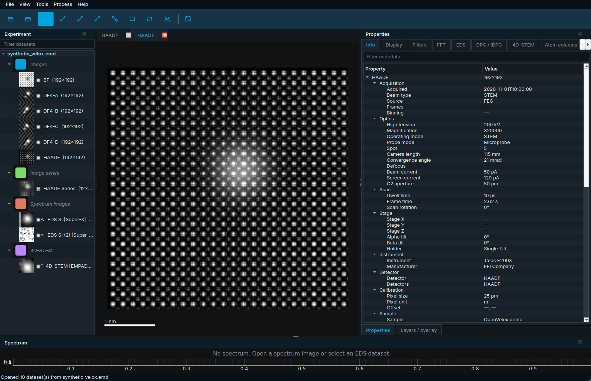
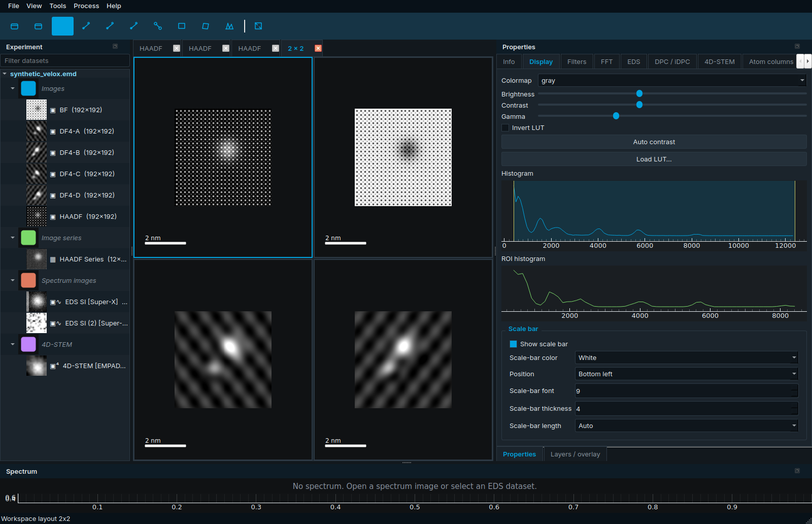
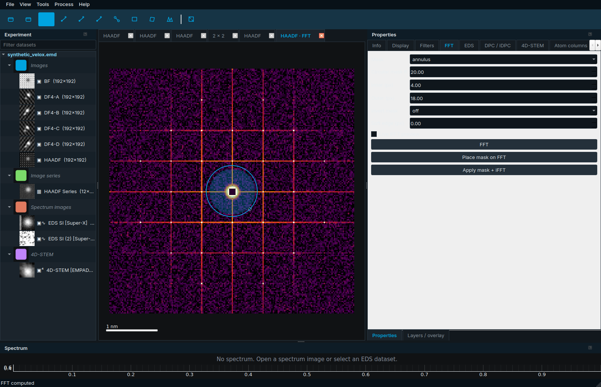
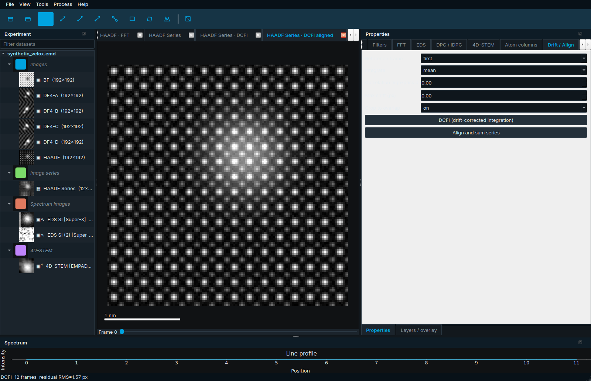
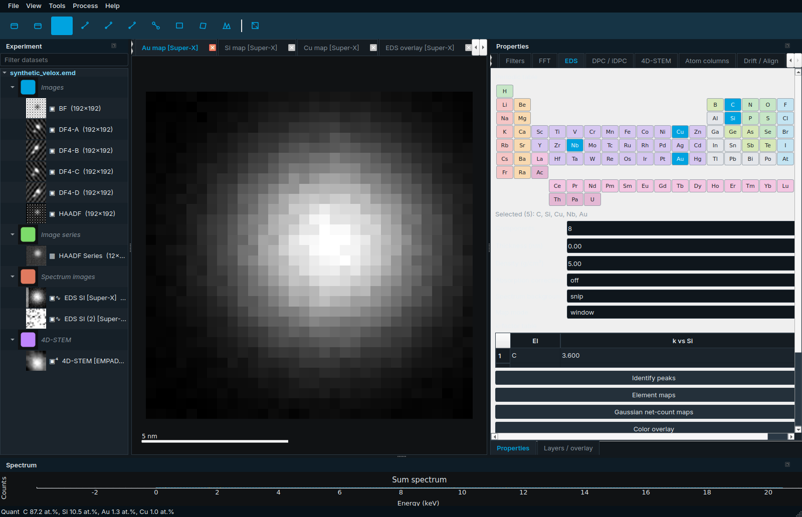
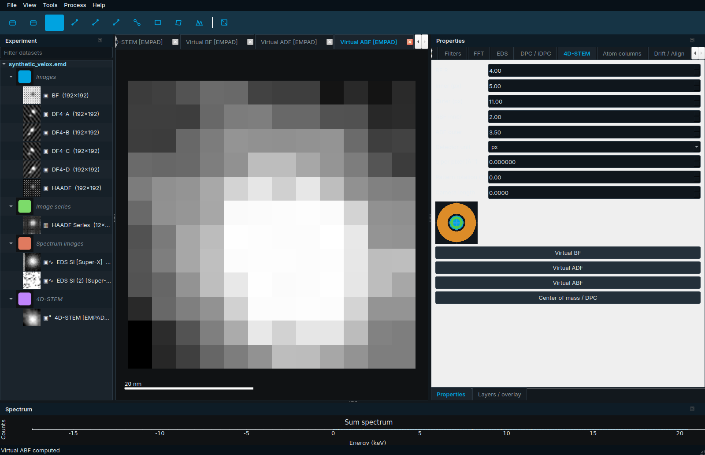
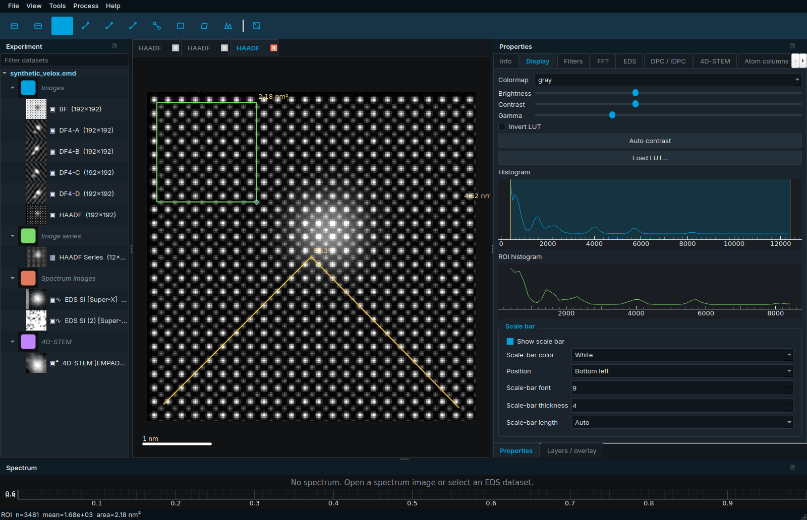
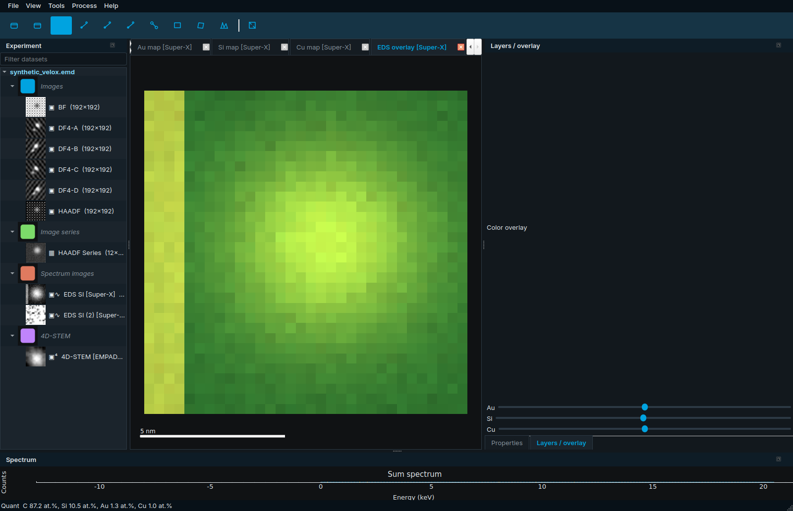

<p align="center">
  
</p>

<h1 align="center">OpenVelox</h1>

<p align="center">
  <strong>Open-source TEM / STEM analysis for Thermo Fisher Velox data</strong><br>
  English · <a href="README.zh-CN.md">简体中文</a>
</p>

<p align="center">
  <a href="LICENSE"></a>
  <a href="https://www.python.org/"></a>
  <a href="https://github.com/xinren1230/OpenVelox/releases"></a>
  <a href="https://github.com/xinren1230/OpenVelox/releases"></a>
</p>

OpenVelox is a desktop app for inspecting and analysing Thermo Fisher (FEI) electron-microscopy data. The chrome, docks, and workflows follow **Thermo Fisher Velox**: experiment browser on the left, a tabbed / tileable image workspace in the centre, property and processing panes on the right, and a spectrum view along the bottom.

It is an independent project by **Xinren Chen**. OpenVelox is **not affiliated with Thermo Fisher Scientific**.

---

## Why it exists

Velox is the native viewer for Talos / Spectra / Themis sessions. It is excellent on a licensed microscope PC and unavailable everywhere else — home laptops, Linux boxes, shared analysis workstations, teaching labs. OpenVelox is the open-source alternative for those rooms:

- Open the same `.emd` session Velox wrote (images, Super-X streams, SI, 4D-STEM, DF4).
- Keep the same left-to-right layout so a microscopist does not have to relearn the desk.
- Cover the daily analysis loop: metadata, LUTs, FFT masks, DCFI, measurements, EDS quantification, virtual detectors, reports.
- Stay free, scriptable, and offline. No microscope control, no license dongle, no GPU lock-in.

Python 3.12, PySide6, and pyqtgraph. A Windows installer ships on [GitHub Releases](https://github.com/xinren1230/OpenVelox/releases); Linux and source installs use the same codebase.

---

## Feature overview vs Velox

Full checklist: [docs/VELOX_PARITY.md](docs/VELOX_PARITY.md). Status is **done** unless marked *partial*.

| Area | Velox feature | OpenVelox 0.5.0 |
| --- | --- | --- |
| Workspace | Experiment / data browser, thumbnails, search | File → kind groups, 40 px previews, filter box |
| Workspace | Click inspects, double-click opens | Same |
| Metadata | Optics / Scan / Stage / Instrument / Detector / Sample | Flattened Velox JSON + searchable raw tree |
| Layout | 1×1 / 1×2 / 2×1 / 2×2 / 1×3 / 2×3, linked zoom | View → Layout; pixel-size-aware sync |
| Display | Contrast, gamma, LUT library | Sliders + histogram window/level; fire / ice / glow / scientific set; ImageJ `.lut` |
| FFT | Masks + iFFT | Circle / annulus / rect, invert, soft edge, live preview |
| Drift | DCFI / align-and-sum | First / previous / mean reference, high-pass, max-shift, overlap crop |
| Filters | Background, unsharp, Sobel, … | Average / rolling ball / plane / constant; median / Wiener / high-pass |
| Image calculator | Expression editor | *Partial* — add / sub / mul / div / invert / normalize |
| Measure | Distance, angle, area, d-spacing | Two- / three-click tools; FFT `d=1/|g|` or `d=2/|Δg|` |
| Annotate | Overlays + scale bar | Styled bar; File → Export overlay burns annotations |
| EDS | Peak ID, backgrounds, Cliff–Lorimer | Linear / SNIP / Velox-like bg; k vs Si; wt.% and at.% |
| EDS | Maps, overlays, line scans, ROI spectra | Window or Gaussian-net maps; mixer; drawn path or mid-row |
| Super-X | Live multi-detector mixer | *Partial* — sparse SpectrumStream + per-detector SI |
| 4D-STEM | Virtual BF / ADF / ABF, CoM, DPC / iDPC | Disk / annulus; px or mrad; DF4 or 4D CoM fallback |
| 4D-STEM | Diffraction calibration | q (Å⁻¹/px) from camera length + λ(HV), rotation |
| Report | Session report | PDF / HTML / PPTX |
| Session | Save / restore workspace | Files, k-factors, chrome, tiles, sync, diffraction |

Microscope control, licensing, and proprietary GPU paths stay **out of scope**.

---

## Screenshots

Captured offscreen from the bundled synthetic Talos-style session (`python scripts/capture_screenshots.py`).

| Main window | Multi-panel linked views |
| --- | --- |
|  |  |

| FFT mask | DCFI |
| --- | --- |
|  |  |

| EDS maps / quantification | 4D-STEM virtual detectors |
| --- | --- |
|  |  |

| Measurements & annotations | Overlay mixer |
| --- | --- |
|  |  |

---

## Installation

### Windows installer

1. Open [Releases](https://github.com/xinren1230/OpenVelox/releases).
2. Download **`OpenVelox-Setup-0.5.0.exe`**.
3. Run the Inno Setup wizard (per-user by default; no Administrator required). Optionally create a desktop icon.
4. Launch **OpenVelox** from the Start menu. `.emd` files can be opened with the app.

The installer writes `OpenVelox.exe` under `%LOCALAPPDATA%\Programs\OpenVelox` (or the folder you choose). Logs live in `%LOCALAPPDATA%\OpenVelox\logs`.

### From source (uv or pip)

Python 3.10–3.12. 3.12 is the tested Windows / PyInstaller target.

```bash
git clone https://github.com/xinren1230/OpenVelox.git
cd OpenVelox

# uv
uv venv
uv pip install -e .

# or pip
python -m pip install -e .
# equivalently: python -m pip install -r requirements.txt
```

On Ubuntu / Debian, install `libegl1` and the usual `libxcb-*` packages if PySide6 fails to import. Headless CI can run with `--offscreen`.

```bash
python -m openvelox
python -m openvelox path/to/session.emd
python -m openvelox --sample
python -m openvelox --sample --lang zh
```

Optional scientific backends (not required):

```text
pip install "openvelox[hyperspy]"   # HyperSpy + RosettaSciIO + exSpy
pip install "openvelox[ncem]"       # ncempy fallback reader
pip install "openvelox[atoms]"      # Atomap
pip install "openvelox[stem4d]"     # py4DSTEM + pyxem
```

### Build the Windows executable (PyInstaller)

From the repo root in PowerShell (Python 3.12 on PATH):

```powershell
powershell -ExecutionPolicy Bypass -File packaging/build_windows.ps1
```

That installs dependencies, runs `packaging/openvelox.spec`, and writes `dist/OpenVelox/OpenVelox.exe` (one-folder). Resources resolve from `sys._MEIPASS` first, so the same spec is one-file compatible if you drop the `COLLECT` block.

Linux:

```bash
bash packaging/build_linux.sh
```

The window icon is `openvelox/resources/openvelox.ico`. A placeholder ICO is generated with Pillow **only when that file is missing** — an existing icon is never overwritten.

### Build the installer (Inno Setup)

`packaging/openvelox.iss` expects a one-file `OpenVelox.exe` next to `packaging/` (the repo root). After PyInstaller:

1. Install [Inno Setup 6](https://jrsoftware.org/isinfo.php).
2. Copy the one-file exe to `OpenVelox.exe` in the repo root (or point `Source` in the `.iss` at your build).
3. Compile:

```bat
iscc packaging\openvelox.iss
```

Output: `dist/OpenVelox-Setup-0.5.0.exe`.

---

## Usage guide

Open the synthetic session any time with **File → Open synthetic sample** or `python -m openvelox --sample`. It is a Velox-like HDF5 `.emd` with HAADF / BF, DF4-A–D, a drifted series, an Au-on-SiNₓ EDS SI plus SpectrumStream, and a small 4D-STEM cube.

### Opening files and supported formats

**File → Open…** (`Ctrl+O`) or drop files onto the window.

| Format | Typical source | What OpenVelox reads |
| --- | --- | --- |
| `.emd` | Velox | `Data/Image`, `Data/Spectrum`, sparse `Data/SpectrumStream`, dense `SpectrumImage`, `EelsSpectrumImage`, `FourDSTEM`, `Operations` / `Displays`. Large arrays stay **lazy** until a view needs them. |
| `.ser` / `.emi` | TIA | Image series + EMI sidecar metadata. |
| `.dm3` / `.dm4` | Gatan DigitalMicrograph | Images / stacks. ncempy or HyperSpy are fallbacks. |
| `.tif` / `.tiff` | Generic / ImageJ | Single frames and stacks. |

A real Velox file is HDF5. The reader walks `Version` JSON, image cubes with a 60 000-byte metadata slab, Super-X `SpectrumStream` (gate pulse `65535` advances the pixel), and display titles such as HAADF / DF4-A / iDPC. Pruned streams that still advertise a stale 128×128 raster are decoded from gate-pulse count and the companion HAADF shape.

Heavy cubes paint a strided preview, then upgrade on a background thread with a progress dialog.

### Experiment browser

The left **Experiment** dock lists each file, then kind groups (image, stack, spectrum, SI, 4D), then datasets with thumbnails.

1. Type in the filter box to match name, kind, or detector.
2. **Click** a dataset — the Info tab shows acquisition metadata.
3. **Double-click** — the dataset opens in the workspace.

### Acquisition metadata

Info tab sections: Optics, Scan, Stage, Instrument, Detector, Calibration, Sample, plus the raw Velox JSON tree. Search the tree from the filter box. Typical fields: high tension, magnification, dwell, pixel size, camera length, convergence, beam current, defocus, spot, stage XYZ / αβ, holder, sample id.

### Display, contrast, and LUTs

Open the **Display** tab.

1. Pick a colormap (`gray`, `gray_inv`, `thermal`, `fire`, `ice`, `glow`, `green`, `red`, `bone`, plus the scientific set).
2. Drag **Brightness / Contrast / Gamma**, or the cyan histogram region (window / level).
3. **Invert LUT** flips the table. **Auto contrast** resets levels.
4. **Load LUT** accepts ImageJ `.lut` or a CSV.
5. Stacks get a frame slider — only the current frame is pulled into RAM.

The status bar shows the pixel value and calibrated coordinates under the cursor. Zoom / pan auto-downsamples so large maps stay interactive.

### Multi-panel and linked views

**View → Layout** offers 1×1, 1×2, 2×1, 2×2, 1×3, 2×3. **View → Tile** jumps to 2×2. The focused tile has a cyan frame.

**View → Synchronize zoom** copies pan / zoom across tiles, scaled by each image’s pixel size, so a 5 nm HAADF and a 5 nm map stay registered.

### FFT, masks, and d-spacing

1. Select an image. **Process → FFT** (`Ctrl+F`) or the FFT tab **Apply**.
2. The log power spectrum opens with a thermal LUT and a DC notch.
3. On the FFT tab choose **circle / annulus / rect**, set radii, optionally **invert** and a **soft** Gaussian edge.
4. Drag the cyan mask on the FFT, or type numbers. **iFFT** reconstructs; enable live preview for a second tab.
5. **Tools → d-spacing** (`G`): two clicks on the FFT. Near the DC, `d = 1/|g|`; two Bragg spots, `d = 2/|Δg|`.

### Filters and background

**Filters** tab, or **Process** menu:

- Gaussian, median, Wiener, unsharp, Sobel, high-pass.
- Background: **average**, **rolling ball**, **plane**, **constant** (percentile).
- **Image calculator** — add / subtract / multiply / divide / invert / normalize two open images.

Heavy jobs run in the background. **View → Undo / Redo** (`Ctrl+Z` / `Ctrl+Y`) walks the last image snapshots.

### DCFI (drift-corrected frame integration)

1. Open an image series (kind **stack**). The synthetic sample includes a drifted HAADF series.
2. Open the **Drift** tab.
3. Choose reference (`first` / `previous` / `mean`), reduce (`mean` / `sum`), optional correlation high-pass, max-shift reject, and overlap crop.
4. **DCFI** writes the integrated frame, the aligned stack, and a drift-magnitude plot in the spectrum dock.
5. **Align and sum** is the older path: DCFI(sum, no crop).

### Measurements and annotations

**Tools** menu (also the toolbar):

| Tool | Shortcut | How |
| --- | --- | --- |
| Pointer | `Esc` | Pan / zoom |
| Line profile | `L` | Two clicks; width on the Filters tab; FWHM / mean in the spectrum dock |
| Distance | `D` | Two clicks; calibrated label |
| Angle | `A` | Three clicks |
| Rectangle ROI | `R` | Drag; n, mean, calibrated area; ROI histogram on Display |
| Ellipse ROI | `Shift+R` | Same stats |
| Polygon ROI | `P` | Click vertices; double-click or close the ring |
| d-spacing | `G` | Two clicks on an FFT |

Overlays stay on the canvas until **Tools → Clear overlays**. On a spectrum image, a ROI also sums an ROI spectrum.

### Scale bar and export

Display tab → **Scale bar**: colour (white / black / cyan / yellow), position, font, thickness, locked length or auto, hide.

| Command | Shortcut | Output |
| --- | --- | --- |
| File → Export image | `Ctrl+E` | PNG / TIFF + optional scale bar and title |
| File → Export overlay | `Ctrl+Shift+V` | Burns annotations + styled bar |
| File → Batch export | `Ctrl+Shift+E` | Every open tab |
| File → Export spectrum / map / quant / ROI / line scan | — | CSV |

### EDS: from peak ID to Cliff–Lorimer to maps

1. Open a spectrum image (or a Super-X stream). The sum spectrum appears in the bottom dock.
2. **EDS** tab: pick a background — **linear**, **SNIP**, or **Velox-like** (`a + b/E + cE`).
3. **Identify peaks**. Labels are staggered on the spectrum; Ka/Kb and La/Lb family lines appear in muted gold. The periodic table fills from the ID; you can click extra elements.
4. Edit **k vs Si** in the k-factor table.
5. **Quantify** — Cliff–Lorimer: wt.% from `k · I`, at.% via atomic weight. Optional thin-film absorption (thickness + density).
6. **Map mode**: window or Gaussian net-count. **Element maps** opens one tab per element.
7. **Overlay** + the **Layers** dock — per-element opacity.
8. Draw a **line profile** on the SI, then **Line scan** (otherwise the mid-row). Export CSV.
9. Draw a ROI, then read the ROI spectrum (background + peak labels).

### 4D-STEM: virtual detectors, CoM, DPC / iDPC, calibration

1. Open a `FourDSTEM` cube, or a session that already has DF4-A/B/C/D.
2. **4D-STEM** tab: BF radius, ADF inner/outer, ABF inner/outer. Unit is **px** or **mrad** (needs camera length + detector pixel).
3. Set **q per pixel (Å⁻¹)** directly, or leave it at 0 and fill camera length — OpenVelox computes q from relativistic λ(HV).
4. **Pattern rotation** is applied to CoM / DPC vectors.
5. **Virtual BF / ADF / ABF** integrate a disk or annulus per probe position. The cartoon shows BF (cyan), ABF (green), ADF (amber) and DPC cross-hairs.
6. **Center of mass / DPC** writes CoM DPC X/Y, iDPC, and dDPC.
7. **DPC** tab: if DF4-A–D exist they are used; otherwise the 4D CoM path runs.

### Reports

**File → Export report…** (`Ctrl+Shift+R`) writes PDF, HTML, or PPTX. The report includes a title page, up to eight open images, the current spectrum, and the quantification table. Unknown suffixes fall back to PDF. No extra Python packages are required (Pillow + a minimal PPTX zip).

### Sessions

**File → Save session** (`Ctrl+Shift+S`) writes `*.openvelox.json` (session format v3): open files, language, k-factors, window geometry, dock state, layout key, linked-view flag, tile dataset refs, diffraction calibration.

**File → Load session** (`Ctrl+Shift+O`) reopens those files and restores chrome, tiles, and calibration. Missing paths are skipped and logged.

Dock layout is also remembered between launches (`View → Reset layout` if a dock goes missing).

---

## Keyboard shortcuts

| Shortcut | Action |
| --- | --- |
| `Ctrl+O` | Open files |
| `Ctrl+Shift+O` | Load session |
| `Ctrl+Shift+S` | Save session |
| `Ctrl+E` | Export image |
| `Ctrl+Shift+V` | Export overlay |
| `Ctrl+Shift+R` | Export report |
| `Ctrl+Shift+E` | Batch export |
| `Ctrl+W` | Close tab |
| `Ctrl+Q` | Quit |
| `Ctrl+0` | Fit view |
| `Ctrl+Z` / `Ctrl+Y` | Undo / redo |
| `Ctrl+F` | FFT |
| `Esc` | Pointer |
| `L` | Line profile |
| `D` | Distance |
| `A` | Angle |
| `G` | FFT d-spacing |
| `R` / `Shift+R` / `P` | Rect / ellipse / polygon ROI |

---

## Logs and troubleshooting

| Platform | Directory |
| --- | --- |
| Windows | `%LOCALAPPDATA%\OpenVelox\logs` |
| Linux / macOS | `~/.local/share/OpenVelox/logs` |

- `openvelox.log` — unexpected Python exceptions (windowed PyInstaller builds have no console).
- `crash.log` — native / faulthandler dumps.

Override the folder with `OPENVELOX_LOG_DIR`. User data (prefs, recent files) lives in `%LOCALAPPDATA%\OpenVelox` or `$XDG_DATA_HOME/OpenVelox`.

| Symptom | What to try |
| --- | --- |
| Blank window / `qt.qpa.plugin` | Install `libegl1` and `libxcb-*`. Cloud / SSH: `python -m openvelox --offscreen`. |
| `.emd` opens with no SI | The file may only have a compressed SpectrumImage blob — OpenVelox prefers `Data/SpectrumStream`. |
| Stale 128×128 EDS raster | The decoder uses gate-pulse count + HAADF shape; reopen after the companion HAADF is listed. |
| `saveState` toolbar warning | 0.5.0 names the main toolbar (`mainToolbar`). Upgrade if you still see it. |
| Missing docks | View → Reset layout. |
| Chinese UI | `python -m openvelox --lang zh` or View → Language → 简体中文. |

```bash
QT_QPA_PLATFORM=offscreen python -m pytest
```

---

## Tests

```bash
python -m pytest
```

Coverage includes Velox EMD / TIFF / SER / DM3 I/O (lazy listing + SpectrumStream codec), optional [public RosettaSciIO Velox examples](https://github.com/hyperspy/rosettasciio) (downloaded at runtime, skipped offline), FFT invertibility, DCFI, measurements, EDS backgrounds and Cliff–Lorimer, 4D virtual detectors and diffraction cal, PDF/HTML/PPTX reports, session v3 tiles, bilingual strings, and a GUI smoke pass that grabs the screenshot gallery.

Set `OPENVELOX_PUBLIC_EMD` to a local cache if you already have those files.

---

## Project layout

```text
openvelox/
  io/           EMD (lazy + SpectrumStream), SER, DM, TIFF, report export
  processing/   FFT, filters, EDS, DPC, 4D-STEM, measurements
  ui/           PySide6 + pyqtgraph docks, browser, multi-panel workspace
  resources/    openvelox.ico, logo.png
packaging/      PyInstaller spec, Inno Setup script, Windows / Linux build scripts
scripts/        sample generator, screenshot capture
tests/
docs/VELOX_PARITY.md
docs/screenshots/
```

---

## Contributing

Issues and pull requests: [github.com/xinren1230/OpenVelox](https://github.com/xinren1230/OpenVelox).

1. Fork, branch from `main`, keep changes focused.
2. Add tests for new behaviour. `QT_QPA_PLATFORM=offscreen python -m pytest` must stay green.
3. Do not insert property-panel tabs before FFT (index 3) or EDS (index 4).
4. Do not add drive-by QActions — `test_every_named_action_trigger` fires all of them.
5. Never overwrite `openvelox/resources/openvelox.ico`.
6. Match the existing dark laboratory theme (`#00A3E0`). No extra component libraries.
7. UI strings go in `openvelox/i18n.py` for both `en` and `zh`.

By contributing you agree that your changes are licensed under **GPL-3.0**.

---

## Acknowledgements

OpenVelox stands on work from the electron-microscopy Python community:

- [HyperSpy](https://hyperspy.org/) and [RosettaSciIO](https://github.com/hyperspy/rosettasciio) — scientific formats and public Velox examples
- [ncempy](https://github.com/ercius/openNCEM) — DigitalMicrograph fallback
- [py4DSTEM](https://github.com/py4dstem/py4DSTEM) and [pyxem](https://github.com/pyxem/pyxem) — 4D-STEM ecosystem
- [Atomap](https://atomap.org/) — atom-column finding
- [pyqtgraph](https://www.pyqtgraph.org/) — interactive image and plot views
- [PySide6](https://doc.qt.io/qtforpython/) — the Qt desktop shell

Thermo Fisher Velox remains the reference commercial workflow. OpenVelox reimplements analysis steps from public file formats and published methods; it does not ship Thermo Fisher code.

---

## Citation

If OpenVelox supports a paper or thesis, please cite the software:

```bibtex
@software{chen_openvelox_2026,
  author  = {Chen, Xinren},
  title   = {OpenVelox},
  year    = {2026},
  version = {0.5.0},
  url     = {https://github.com/xinren1230/OpenVelox},
  license = {GPL-3.0}
}
```

Chen, X. (2026). *OpenVelox* (Version 0.5.0) [Computer software]. https://github.com/xinren1230/OpenVelox

---

## License

[GNU General Public License v3.0](LICENSE) — see [LICENSE](LICENSE).

Copyright (C) 2026 Xinren Chen.

Public Velox example files used by optional tests come from [RosettaSciIO](https://github.com/hyperspy/rosettasciio) and remain under that project’s license; they are not shipped with OpenVelox.
