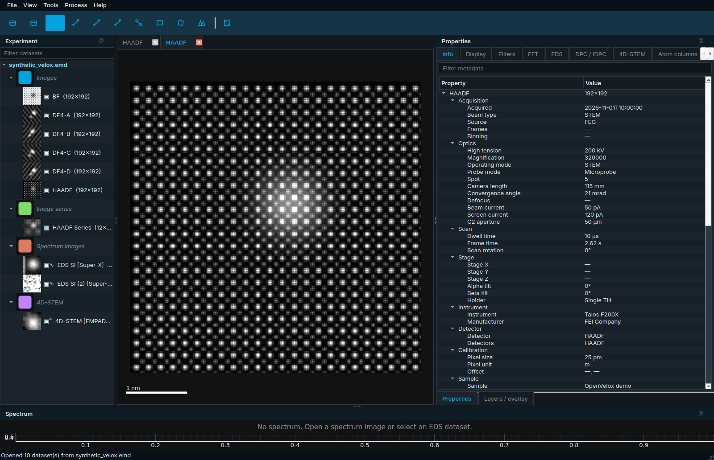
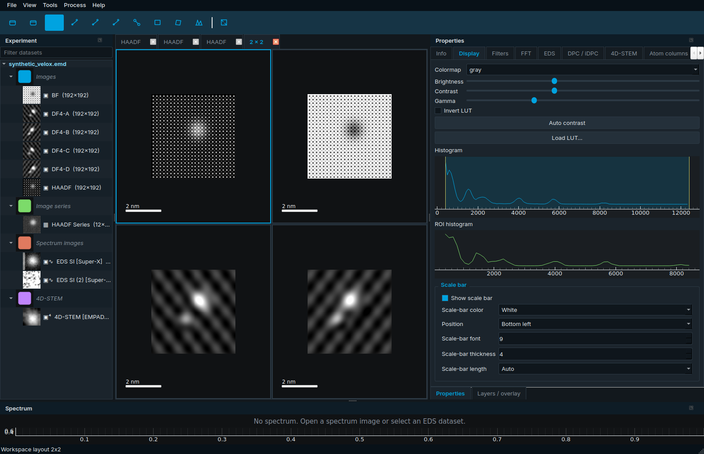
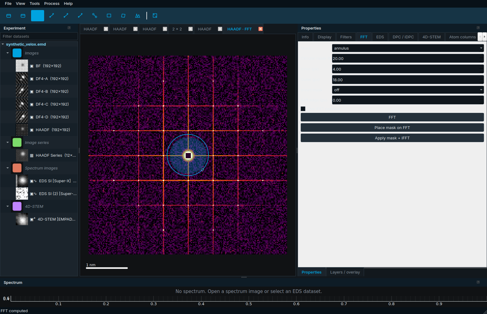
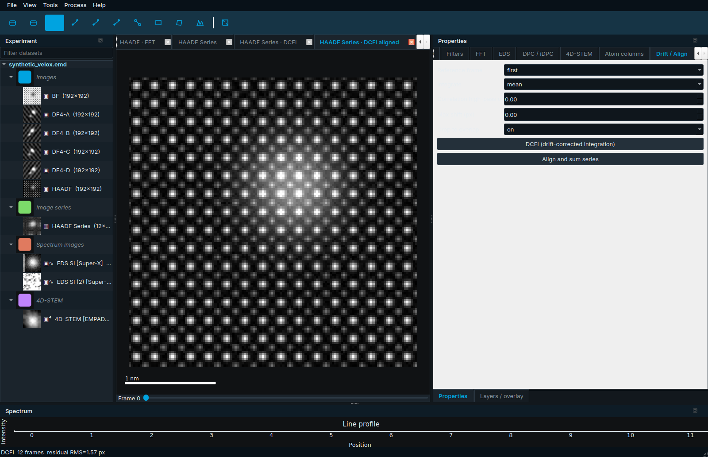
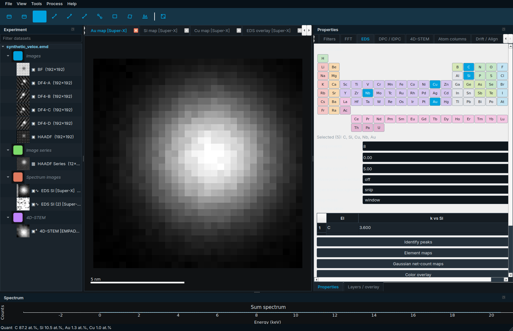
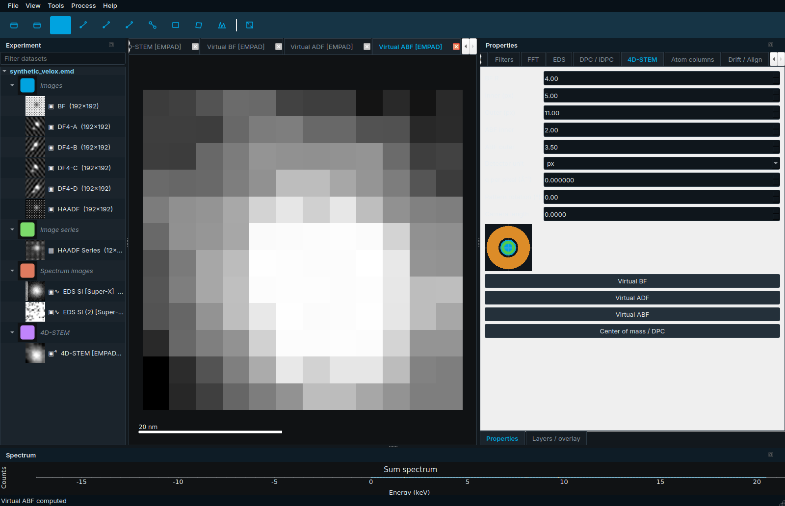
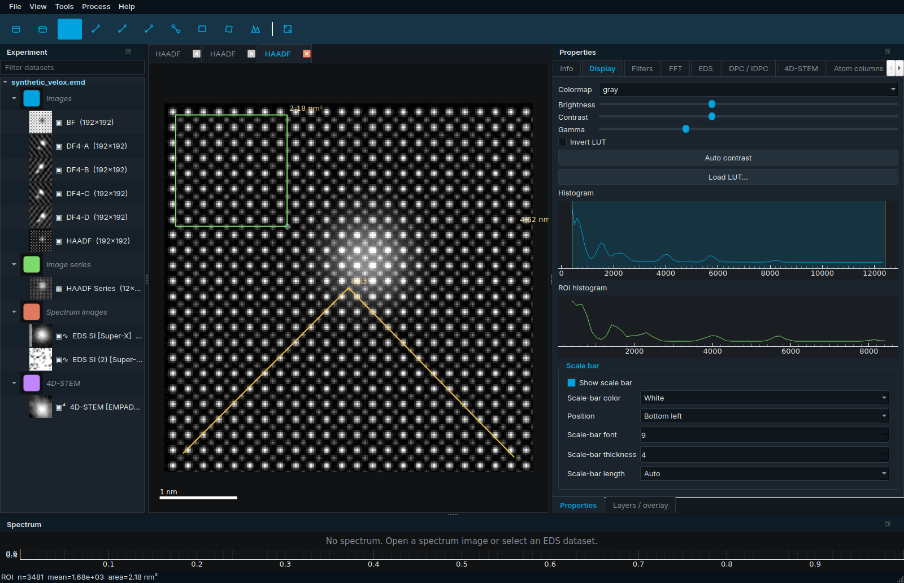
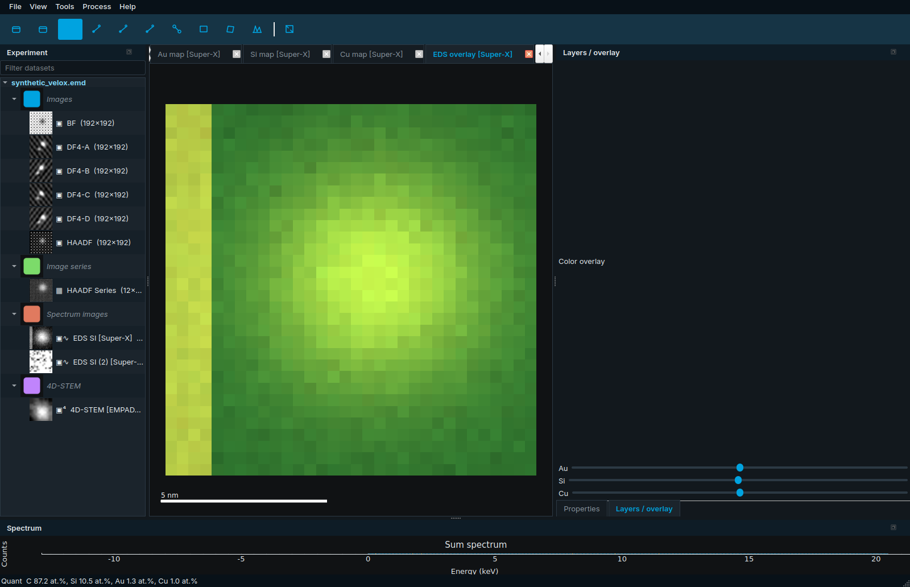

<p align="center">
  
</p>

<h1 align="center">OpenVelox</h1>

<p align="center">
  <strong>面向 Thermo Fisher Velox 数据的开源 TEM / STEM 分析软件</strong><br>
  <a href="README.md">English</a> · 简体中文
</p>

<p align="center">
  <a href="LICENSE"></a>
  <a href="https://www.python.org/"></a>
  <a href="https://github.com/xinren1230/OpenVelox/releases"></a>
  <a href="https://github.com/xinren1230/OpenVelox/releases"></a>
</p>

OpenVelox 是用于查看与分析 Thermo Fisher（FEI）电子显微数据的桌面软件。界面与工作流对齐 **Thermo Fisher Velox**：左侧实验浏览器、中间可标签 / 分屏的图像工作区、右侧属性与处理面板、底部能谱视图。

项目由 **Xinren Chen** 独立开发。OpenVelox **与 Thermo Fisher Scientific 无任何隶属关系**。

---

## 为什么做这个软件

Velox 是 Talos / Spectra / Themis 会话的官方查看器，在授权显微镜电脑上很好用，但在家庭笔记本、Linux 工作站、公共机房和教学实验室往往装不上。OpenVelox 就是这些场景下的开源替代：

- 打开 Velox 写出的同一份 `.emd`（图像、Super-X 流、谱图、4D-STEM、DF4）。
- 保持从左到右的熟悉布局，不必重新学习整张桌子。
- 覆盖日常分析：元数据、LUT、FFT 掩模、DCFI、测量、EDS 定量、虚拟探测器、报告。
- 免费、可脚本化、可离线。不做镜控、不绑加密狗、不绑专有 GPU。

技术栈为 Python 3.12、PySide6、pyqtgraph。Windows 安装包发布在 [GitHub Releases](https://github.com/xinren1230/OpenVelox/releases)；Linux 与源码安装共用同一仓库。

---

## 与 Velox 的功能对照

完整清单见 [docs/VELOX_PARITY.md](docs/VELOX_PARITY.md)。除标注 *部分实现* 外均为 **已完成**。

| 类别 | Velox 功能 | OpenVelox 0.5.0 |
| --- | --- | --- |
| 工作区 | 实验 / 数据浏览器、缩略图、搜索 | 文件 → 类型分组、40 px 预览、过滤框 |
| 工作区 | 单击查看、双击打开 | 相同 |
| 元数据 | 光学 / 扫描 / 样品台 / 仪器 / 探测器 / 样品 | 展开 Velox JSON + 可搜索原始树 |
| 布局 | 1×1 / 1×2 / 2×1 / 2×2 / 1×3 / 2×3，联动缩放 | 查看 → 布局；按像素尺寸同步 |
| 显示 | 衬度、伽马、LUT 库 | 滑块 + 直方图窗位；fire / ice / glow / 科学色表；ImageJ `.lut` |
| FFT | 掩模 + 逆变换 | 圆 / 环 / 矩形、反选、软边、实时预览 |
| 漂移 | DCFI / 对齐累加 | first / previous / mean 参考、高通、最大位移、重叠裁剪 |
| 滤波 | 背底、反锐化、Sobel 等 | 平均 / 滚球 / 平面 / 常数；中值 / Wiener / 高通 |
| 图像计算器 | 表达式编辑器 | *部分实现* — 加减乘除 / 反转 / 归一化 |
| 测量 | 距离、角度、面积、晶面间距 | 两击 / 三击；FFT `d=1/|g|` 或 `d=2/|Δg|` |
| 标注 | 叠加与标尺 | 可调标尺；文件 → 导出叠加层烧录标注 |
| EDS | 峰识别、背底、Cliff–Lorimer | 线性 / SNIP / Velox 型背底；相对 Si 的 k；wt.% 与 at.% |
| EDS | 面分布、叠彩、线扫描、ROI 谱 | 窗口或高斯净计数；混合器；手绘路径或中行 |
| Super-X | 实时多探头混合 | *部分实现* — 稀疏 SpectrumStream + 分探头 SI |
| 4D-STEM | 虚拟 BF / ADF / ABF、质心、DPC / iDPC | 圆盘 / 圆环；px 或 mrad；DF4 或 4D 质心回退 |
| 4D-STEM | 衍射标定 | 由相机长度 + λ(加速电压) 得到 q（Å⁻¹/px），可旋转 |
| 报告 | 会话报告 | PDF / HTML / PPTX |
| 会话 | 保存 / 恢复工作区 | 文件、k 因子、窗口、分屏、联动、衍射标定 |

镜控、授权与专有 GPU 路径 **不在范围内**。

---

## 截图

由捆绑的合成 Talos 风格会话离屏抓取（`python scripts/capture_screenshots.py`）。

| 主窗口 | 多分屏联动 |
| --- | --- |
|  |  |

| FFT 掩模 | DCFI |
| --- | --- |
|  |  |

| EDS 面分布 / 定量 | 4D-STEM 虚拟探测器 |
| --- | --- |
|  |  |

| 测量与标注 | 叠彩混合器 |
| --- | --- |
|  |  |

---

## 安装

### Windows 安装包

1. 打开 [Releases](https://github.com/xinren1230/OpenVelox/releases)。
2. 下载 **`OpenVelox-Setup-0.5.0.exe`**。
3. 运行 Inno Setup 向导（默认当前用户，无需管理员）。可选择创建桌面图标。
4. 从开始菜单启动 **OpenVelox**。`.emd` 可用本程序打开。

安装目录默认为 `%LOCALAPPDATA%\Programs\OpenVelox`（或你选择的文件夹）。日志在 `%LOCALAPPDATA%\OpenVelox\logs`。

### 从源码安装（uv 或 pip）

需要 Python 3.10–3.12。Windows / PyInstaller 以 3.12 为测试目标。

```bash
git clone https://github.com/xinren1230/OpenVelox.git
cd OpenVelox

# uv
uv venv
uv pip install -e .

# 或 pip
python -m pip install -e .
# 等价：python -m pip install -r requirements.txt
```

Ubuntu / Debian 若 PySide6 无法导入，请安装 `libegl1` 与常用 `libxcb-*`。无界面环境可加 `--offscreen`。

```bash
python -m openvelox
python -m openvelox path/to/session.emd
python -m openvelox --sample
python -m openvelox --sample --lang zh
```

可选科学后端（非必需）：

```text
pip install "openvelox[hyperspy]"   # HyperSpy + RosettaSciIO + exSpy
pip install "openvelox[ncem]"       # ncempy 回退读取
pip install "openvelox[atoms]"      # Atomap
pip install "openvelox[stem4d]"     # py4DSTEM + pyxem
```

### 用 PyInstaller 打包 Windows 可执行文件

在仓库根目录的 PowerShell（PATH 上有 Python 3.12）：

```powershell
powershell -ExecutionPolicy Bypass -File packaging/build_windows.ps1
```

脚本安装依赖、运行 `packaging/openvelox.spec`，写出 `dist/OpenVelox/OpenVelox.exe`（单文件夹）。资源优先从 `sys._MEIPASS` 解析，去掉 `COLLECT` 即可做成单文件。

Linux：

```bash
bash packaging/build_linux.sh
```

窗口图标为 `openvelox/resources/openvelox.ico`。仅当该文件不存在时才会用 Pillow 生成占位 ICO——**已有图标永不覆盖**。

### 用 Inno Setup 制作安装包

`packaging/openvelox.iss` 期望仓库根目录有单文件 `OpenVelox.exe`。打包完成后：

1. 安装 [Inno Setup 6](https://jrsoftware.org/isinfo.php)。
2. 将单文件 exe 复制为仓库根目录的 `OpenVelox.exe`（或修改 `.iss` 中的 `Source`）。
3. 编译：

```bat
iscc packaging\openvelox.iss
```

产物：`dist/OpenVelox-Setup-0.5.0.exe`。

---

## 使用指南

随时可用 **文件 → 打开合成示例数据** 或 `python -m openvelox --sample` 打开合成会话。它是一份 Velox 风格的 HDF5 `.emd`，含 HAADF / BF、DF4-A–D、带漂移的序列、Au-on-SiNₓ 的 EDS SI 与 SpectrumStream，以及一小块 4D-STEM 数据。

### 打开文件与支持格式

**文件 → 打开…**（`Ctrl+O`）或把文件拖进窗口。

| 格式 | 常见来源 | OpenVelox 读取内容 |
| --- | --- | --- |
| `.emd` | Velox | `Data/Image`、`Data/Spectrum`、稀疏 `Data/SpectrumStream`、稠密 `SpectrumImage`、`EelsSpectrumImage`、`FourDSTEM`、`Operations` / `Displays`。大数组保持**惰性**，视图需要时才读入。 |
| `.ser` / `.emi` | TIA | 图像序列 + EMI 侧车元数据。 |
| `.dm3` / `.dm4` | Gatan DigitalMicrograph | 图像 / 堆栈。ncempy 或 HyperSpy 作回退。 |
| `.tif` / `.tiff` | 通用 / ImageJ | 单帧与堆栈。 |

真实 Velox 文件是 HDF5。读取器会走 `Version` JSON、带 60 000 字节元数据块的图像、Super-X `SpectrumStream`（门脉冲 `65535` 推进像素），以及 HAADF / DF4-A / iDPC 等显示标题。仍宣称 128×128 的裁剪流会按门脉冲计数与配套 HAADF 形状解码。

大立方体先画降采样预览，再在后台线程升级，并弹出进度框。

### 实验浏览器

左侧 **实验** 停靠栏按文件 → 类型（图像、堆栈、能谱、SI、4D）→ 带缩略图的数据集列出。

1. 在过滤框输入名称、类型或探测器。
2. **单击**数据集 — Info 页显示采集元数据。
3. **双击** — 在工作区打开。

### 采集元数据

Info 分页：光学、扫描、样品台、仪器、探测器、标定、样品，以及原始 Velox JSON 树。可用过滤框搜索。常见字段：加速电压、放大倍数、驻留时间、像素尺寸、相机长度、会聚角、束流、离焦、光斑、台面 XYZ / αβ、样品杆、样品编号。

### 显示、衬度与 LUT

打开 **显示** 分页。

1. 选择色表（`gray`、`gray_inv`、`thermal`、`fire`、`ice`、`glow`、`green`、`red`、`bone` 及科学色表）。
2. 拖动 **亮度 / 衬度 / 伽马**，或青色直方图区间（窗宽 / 窗位）。
3. **反转 LUT** 翻转色表。**自动衬度** 重置电平。
4. **载入 LUT** 接受 ImageJ `.lut` 或 CSV。
5. 堆栈有帧滑块 — 只把当前帧读入内存。

状态栏显示光标处的像素值与标定坐标。缩放 / 平移会自动降采样，大图仍可流畅操作。

### 多分屏与联动视图

**查看 → 布局** 提供 1×1、1×2、2×1、2×2、1×3、2×3。**查看 → 平铺** 直接进入 2×2。当前格有青色边框。

**查看 → 同步缩放** 按各图像像素尺寸复制平移 / 缩放，使 5 nm 的 HAADF 与 5 nm 的面分布保持对齐。

### FFT、掩模与晶面间距

1. 选中图像。**处理 → FFT**（`Ctrl+F`）或 FFT 分页的应用按钮。
2. 打开带热色表与 DC 凹陷的对数功率谱。
3. 在 FFT 分页选择 **圆 / 环 / 矩形**，设置半径，可选 **反选** 与 **软边**。
4. 在 FFT 上拖动青色掩模，或直接输入数值。**逆 FFT** 重建；打开实时预览会多一个标签页。
5. **工具 → 晶面间距**（`G`）：在 FFT 上点两下。靠近 DC 时 `d = 1/|g|`；两个 Bragg 斑时 `d = 2/|Δg|`。

### 滤波与背底

**滤波** 分页，或 **处理** 菜单：

- 高斯、中值、Wiener、反锐化、Sobel、高通。
- 背底：**平均**、**滚球**、**平面**、**常数**（百分位）。
- **图像计算器** — 对两幅已打开图像做加减乘除 / 反转 / 归一化。

重计算在后台运行。**查看 → 撤销 / 重做**（`Ctrl+Z` / `Ctrl+Y`）回退最近的图像快照。

### DCFI（漂移校正帧积分）

1. 打开图像序列（类型为 **stack**）。合成示例含带漂移的 HAADF 序列。
2. 打开 **漂移** 分页。
3. 选择参考（`first` / `previous` / `mean`）、归约（`mean` / `sum`）、可选相关高通、最大位移拒绝、重叠裁剪。
4. **DCFI** 写出积分帧、对齐堆栈，并在能谱栏画漂移幅度。
5. **对齐并累加** 是旧路径：DCFI（求和、不裁剪）。

### 测量与标注

**工具** 菜单（工具栏同样有）：

| 工具 | 快捷键 | 用法 |
| --- | --- | --- |
| 指针 | `Esc` | 平移 / 缩放 |
| 线轮廓 | `L` | 点两下；线宽在滤波分页；FWHM / 均值在能谱栏 |
| 距离 | `D` | 点两下；带标定标签 |
| 角度 | `A` | 点三下 |
| 矩形 ROI | `R` | 拖拽；像素数、均值、标定面积；显示分页有 ROI 直方图 |
| 椭圆 ROI | `Shift+R` | 同样统计 |
| 多边形 ROI | `P` | 单击顶点，双击或闭合 |
| 晶面间距 | `G` | 在 FFT 上点两下 |

叠加层会留在画布上，直到 **工具 → 清除叠加**。在谱图上画 ROI 还会求和 ROI 谱。

### 标尺与导出

显示分页 → **标尺**：颜色（白 / 黑 / 青 / 黄）、位置、字号、线宽、锁定长度或自动、隐藏。

| 命令 | 快捷键 | 输出 |
| --- | --- | --- |
| 文件 → 导出图像 | `Ctrl+E` | PNG / TIFF，可选标尺与标题 |
| 文件 → 导出叠加层 | `Ctrl+Shift+V` | 烧录标注 + 样式化标尺 |
| 文件 → 批量导出 | `Ctrl+Shift+E` | 所有打开的标签页 |
| 文件 → 导出能谱 / 面分布 / 定量 / ROI / 线扫描 | — | CSV |

### EDS：从寻峰到 Cliff–Lorimer 再到面分布

1. 打开谱图（或 Super-X 流）。底部停靠栏出现求和谱。
2. **EDS** 分页：选择背底 — **线性**、**SNIP** 或 **Velox 型**（`a + b/E + cE`）。
3. **识别峰**。标签在谱上错开排列；Ka/Kb、La/Lb 族线为暗金色。周期表按识别结果填充，也可再点选元素。
4. 在 k 因子表中编辑相对 **Si** 的 k。
5. **定量** — Cliff–Lorimer：由 `k · I` 得 wt.%，再经原子量得 at.%。可选薄膜吸收（厚度 + 密度）。
6. **面分布模式**：窗口或高斯净计数。**元素面分布** 为每个元素打开一页。
7. **叠彩** + **图层** 停靠栏 — 按元素调透明度。
8. 在 SI 上画 **线轮廓**，再点 **线扫描**（否则用中行）。可导出 CSV。
9. 画 ROI，读取带背底与峰标签的 ROI 谱。

### 4D-STEM：虚拟探测器、质心、DPC / iDPC、标定

1. 打开 `FourDSTEM` 立方体，或已含 DF4-A/B/C/D 的会话。
2. **4D-STEM** 分页：BF 半径、ADF 内外径、ABF 内外径。单位为 **px** 或 **mrad**（后者需要相机长度 + 探测器像素）。
3. 直接填写 **每像素 q（Å⁻¹）**，或留 0 并填写相机长度 — OpenVelox 用相对论 λ(加速电压) 计算 q。
4. **图案旋转** 作用于质心 / DPC 矢量。
5. **虚拟 BF / ADF / ABF** 对每个探针位置积分圆盘或圆环。示意图：BF 青、ABF 绿、ADF 琥珀，以及 DPC 十字。
6. **质心 / DPC** 写出 CoM DPC X/Y、iDPC、dDPC。
7. **DPC** 分页：若存在 DF4-A–D 则用之，否则走 4D 质心路径。

### 报告

**文件 → 导出报告…**（`Ctrl+Shift+R`）写出 PDF、HTML 或 PPTX。报告含标题页、最多八幅已打开图像、当前能谱与定量表。未知后缀回退为 PDF。不依赖额外 Python 包（Pillow + 最小 PPTX zip）。

### 会话

**文件 → 保存会话**（`Ctrl+Shift+S`）写出 `*.openvelox.json`（会话格式 v3）：打开的文件、语言、k 因子、窗口几何、停靠状态、布局键、联动开关、分屏数据集引用、衍射标定。

**文件 → 加载会话**（`Ctrl+Shift+O`）重新打开这些文件并恢复窗口、分屏与标定。缺失路径会被跳过并记入日志。

停靠布局也会在两次启动之间记住（停靠栏消失时用 **查看 → 重置布局**）。

---

## 键盘快捷键

| 快捷键 | 操作 |
| --- | --- |
| `Ctrl+O` | 打开文件 |
| `Ctrl+Shift+O` | 加载会话 |
| `Ctrl+Shift+S` | 保存会话 |
| `Ctrl+E` | 导出图像 |
| `Ctrl+Shift+V` | 导出叠加层 |
| `Ctrl+Shift+R` | 导出报告 |
| `Ctrl+Shift+E` | 批量导出 |
| `Ctrl+W` | 关闭标签页 |
| `Ctrl+Q` | 退出 |
| `Ctrl+0` | 适应窗口 |
| `Ctrl+Z` / `Ctrl+Y` | 撤销 / 重做 |
| `Ctrl+F` | FFT |
| `Esc` | 指针 |
| `L` | 线轮廓 |
| `D` | 距离 |
| `A` | 角度 |
| `G` | FFT 晶面间距 |
| `R` / `Shift+R` / `P` | 矩形 / 椭圆 / 多边形 ROI |

---

## 日志与排错

| 平台 | 目录 |
| --- | --- |
| Windows | `%LOCALAPPDATA%\OpenVelox\logs` |
| Linux / macOS | `~/.local/share/OpenVelox/logs` |

- `openvelox.log` — 未捕获的 Python 异常（窗口化 PyInstaller 构建没有控制台）。
- `crash.log` — 原生 / faulthandler 转储。

可用 `OPENVELOX_LOG_DIR` 覆盖目录。用户数据（偏好、最近文件）在 `%LOCALAPPDATA%\OpenVelox` 或 `$XDG_DATA_HOME/OpenVelox`。

| 现象 | 处理 |
| --- | --- |
| 白屏 / `qt.qpa.plugin` | 安装 `libegl1` 与 `libxcb-*`。云端 / SSH：`python -m openvelox --offscreen`。 |
| `.emd` 打开后没有 SI | 文件可能只有压缩的 SpectrumImage 块 — OpenVelox 优先读 `Data/SpectrumStream`。 |
| EDS 光栅仍是陈旧的 128×128 | 解码器使用门脉冲计数 + HAADF 形状；配套 HAADF 列出后再打开。 |
| `saveState` 工具栏警告 | 0.5.0 已为主工具栏命名（`mainToolbar`）。若仍出现请升级。 |
| 停靠栏消失 | 查看 → 重置布局。 |
| 中文界面 | `python -m openvelox --lang zh`，或 查看 → 语言 → 简体中文。 |

```bash
QT_QPA_PLATFORM=offscreen python -m pytest
```

---

## 测试

```bash
python -m pytest
```

覆盖 Velox EMD / TIFF / SER / DM3 读写（惰性列举 + SpectrumStream 编解码）、可选的 [RosettaSciIO 公开 Velox 示例](https://github.com/hyperspy/rosettasciio)（运行时下载，离线则跳过）、FFT 可逆性、DCFI、测量、EDS 背底与 Cliff–Lorimer、4D 虚拟探测器与衍射标定、PDF/HTML/PPTX 报告、会话 v3 分屏、中英字符串，以及会抓取截图廊的 GUI 冒烟测试。

若本地已有这些文件，设置 `OPENVELOX_PUBLIC_EMD` 指向缓存即可。

---

## 仓库结构

```text
openvelox/
  io/           EMD（惰性 + SpectrumStream）、SER、DM、TIFF、报告导出
  processing/   FFT、滤波、EDS、DPC、4D-STEM、测量
  ui/           PySide6 + pyqtgraph 停靠栏、浏览器、多分屏工作区
  resources/    openvelox.ico、logo.png
packaging/      PyInstaller 配置、Inno Setup 脚本、Windows / Linux 构建脚本
scripts/        示例生成、截图抓取
tests/
docs/VELOX_PARITY.md
docs/screenshots/
```

---

## 参与贡献

议题与拉取请求：[github.com/xinren1230/OpenVelox](https://github.com/xinren1230/OpenVelox)。

1. Fork，从 `main` 拉分支，改动保持聚焦。
2. 为新行为补测试。`QT_QPA_PLATFORM=offscreen python -m pytest` 必须保持全绿。
3. 不要在属性面板 FFT（索引 3）或 EDS（索引 4）之前插入分页。
4. 不要随意增加 QAction — `test_every_named_action_trigger` 会触发全部动作。
5. 永远不要覆盖 `openvelox/resources/openvelox.ico`。
6. 沿用现有实验室深色主题（`#00A3E0`）。不要引入第二套组件库。
7. 界面字符串写入 `openvelox/i18n.py` 的 `en` 与 `zh`。

提交即表示同意改动以 **GPL-3.0** 授权。

---

## 致谢

OpenVelox 建立在电子显微 Python 社区的工作之上：

- [HyperSpy](https://hyperspy.org/) 与 [RosettaSciIO](https://github.com/hyperspy/rosettasciio) — 科学格式与公开 Velox 示例
- [ncempy](https://github.com/ercius/openNCEM) — DigitalMicrograph 回退
- [py4DSTEM](https://github.com/py4dstem/py4DSTEM) 与 [pyxem](https://github.com/pyxem/pyxem) — 4D-STEM 生态
- [Atomap](https://atomap.org/) — 原子柱寻找
- [pyqtgraph](https://www.pyqtgraph.org/) — 交互图像与绘图
- [PySide6](https://doc.qt.io/qtforpython/) — Qt 桌面壳

Thermo Fisher Velox 仍是商业参考工作流。OpenVelox 依据公开文件格式与已发表方法重实现分析步骤，不附带 Thermo Fisher 代码。

---

## 引用

若 OpenVelox 支撑了论文或学位论文，请引用本软件：

```bibtex
@software{chen_openvelox_2026,
  author  = {Chen, Xinren},
  title   = {OpenVelox},
  year    = {2026},
  version = {0.5.0},
  url     = {https://github.com/xinren1230/OpenVelox},
  license = {GPL-3.0}
}
```

Chen, X. (2026). *OpenVelox* (Version 0.5.0) [Computer software]. https://github.com/xinren1230/OpenVelox

---

## 许可证

[GNU General Public License v3.0](LICENSE) — 见 [LICENSE](LICENSE)。

Copyright (C) 2026 Xinren Chen。

可选测试使用的公开 Velox 示例来自 [RosettaSciIO](https://github.com/hyperspy/rosettasciio)，仍遵循该项目许可证；OpenVelox 不随附这些文件。
